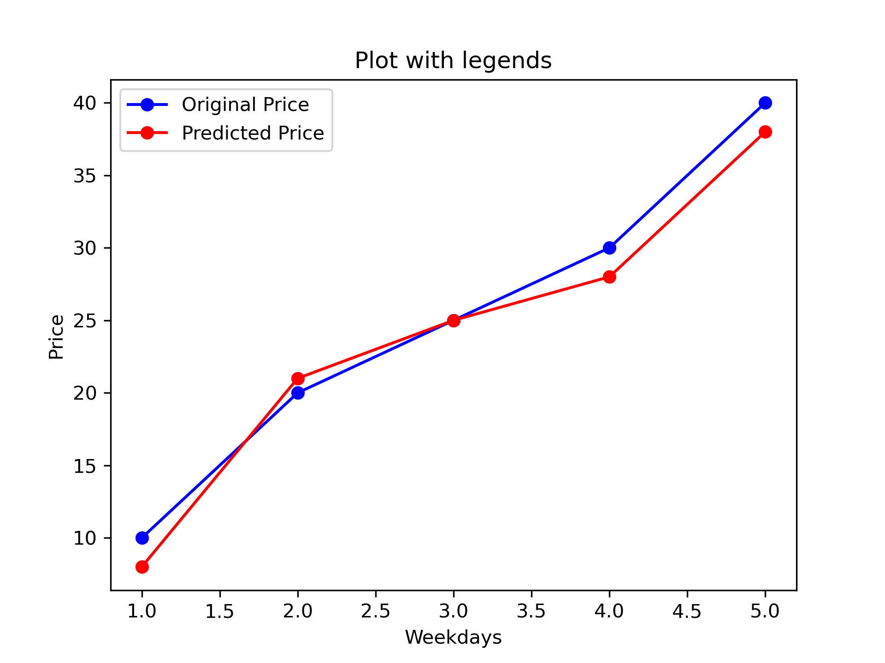

# Stock Prediction Portal

A full-stack web application for predicting stock prices using a Long Short-Term Memory (LSTM) deep learning model. Users can register, manage a personal watchlist, view live market prices, and generate detailed stock forecasts backed by 10 years of historical data.



---

## Features

- **LSTM-based stock prediction** — forecasts closing prices using a pre-trained Keras model trained on historical data
- **Interactive charts** — closing price history, 100-day moving average, 200-day moving average, and final prediction vs actual
- **Model evaluation metrics** — Mean Squared Error (MSE), Root MSE (RMSE), and R² score for each prediction
- **Live market feed** — real-time price, change, and percentage change for watchlist tickers, refreshed every 5 seconds
- **Portfolio / Watchlist** — add up to 10 tickers, persist them per user, and load any symbol into the prediction form with one click
- **JWT authentication** — secure register, login, and token-refresh flow with 15-minute access tokens
- **Profile management** — view and update username and email

---

## Tech Stack

| Layer | Technology |
|---|---|
| Frontend | React 19, Vite, React Router v6, Axios, Font Awesome |
| Backend | Django 5, Django REST Framework, SimpleJWT, django-cors-headers |
| ML Model | Keras (LSTM), scikit-learn, NumPy, pandas, Matplotlib |
| Data source | yfinance (10 years of historical OHLCV data) |
| Database | SQLite (default) |

---

## Project Structure

```
Stock-Prediction_Portal_Python_ML/
├── backend-drf/                  # Django REST Framework backend
│   ├── accounts/                 # User auth, portfolio & profile APIs
│   ├── api/                      # Stock prediction & live-price APIs
│   ├── stock_prediction_main/    # Django project settings & URLs
│   ├── stock_prediction_model.keras  # Pre-trained LSTM model
│   └── manage.py
├── frontend-react/               # React + Vite frontend
│   └── src/
│       ├── components/
│       │   ├── dashboard/        # Main prediction dashboard
│       │   ├── Login.jsx
│       │   ├── Register.jsx
│       │   └── Profile.jsx
│       ├── AuthProvider.jsx
│       ├── PrivateRoute.jsx
│       └── axiosInstance.js
└── Resources/                    # Jupyter notebooks & sample data
    ├── stock_prediction_using_LSTM.ipynb
    ├── LSTM Stock Prediction-Copy1.ipynb
    └── TSLA.csv
```

---

## Getting Started

### Prerequisites

- Python 3.10+
- Node.js 18+
- npm

---

### Backend Setup

```bash
cd backend-drf

# Create and activate a virtual environment
python -m venv venv
source venv/bin/activate   # Windows: venv\Scripts\activate

# Install dependencies
pip install django djangorestframework djangorestframework-simplejwt \
    django-cors-headers python-decouple yfinance keras tensorflow \
    scikit-learn pandas numpy matplotlib
```

Create a `.env` file inside `backend-drf/`:

```env
SECRET_KEY=your-django-secret-key-here
DEBUG=True
```

Run migrations and start the server:

```bash
python manage.py migrate
python manage.py runserver
```

The API will be available at `http://localhost:8000/api/v1/`.

---

### Frontend Setup

```bash
cd frontend-react

npm install
```

Create a `.env` file inside `frontend-react/`:

```env
VITE_BACKEND_ROOT=http://localhost:8000
VITE_API_BASE_URL=http://localhost:8000/api/v1
```

Start the development server:

```bash
npm run dev
```

The app will be available at `http://localhost:5173`.

---

## API Reference

All endpoints are prefixed with `/api/v1/`.

| Method | Endpoint | Auth | Description |
|---|---|---|---|
| `POST` | `/register/` | ✗ | Create a new user account |
| `POST` | `/token/` | ✗ | Obtain JWT access & refresh tokens |
| `POST` | `/token/refresh/` | ✗ | Refresh an access token |
| `GET` | `/protected-view/` | ✓ | Verify token and return user info |
| `GET/PATCH` | `/profile/` | ✓ | View or update username/email |
| `GET/POST` | `/portfolio/` | ✓ | Retrieve or update watchlist tickers |
| `POST` | `/predict/` | ✓ | Run LSTM prediction for a ticker |
| `POST` | `/live-prices/` | ✓ | Fetch live price data for a list of tickers |

### Prediction request / response

**Request**
```json
{ "ticker": "RELIANCE.NS" }
```

**Response**
```json
{
  "status": "success",
  "plot_img": "/media/RELIANCE.NS_plot.png",
  "plot_100_dma": "/media/RELIANCE.NS_100_dma.png",
  "plot_200_dma": "/media/RELIANCE.NS_200_dma.png",
  "plot_prediction": "/media/RELIANCE.NS_final_prediction.png",
  "mse": 1234.56,
  "rmse": 35.13,
  "r2": 0.92
}
```

---

## How the Prediction Works

1. **Data fetch** — 10 years of daily closing prices are downloaded via `yfinance`.
2. **Preprocessing** — the closing price is normalised to [0, 1] using `MinMaxScaler`. The first 70% of rows are used for context; the remaining 30% form the test set.
3. **Inference** — sequences of 100 consecutive days are fed into the pre-trained LSTM model (`stock_prediction_model.keras`).
4. **Post-processing** — predictions are inverse-transformed back to the original price scale.
5. **Evaluation** — MSE, RMSE, and R² are computed against the actual test prices and returned alongside chart images.

---

## Notebooks

The `Resources/` folder contains Jupyter notebooks used during model development:

| Notebook | Purpose |
|---|---|
| `stock_prediction_using_LSTM.ipynb` | Main model training & evaluation notebook |
| `LSTM Stock Prediction-Copy1.ipynb` | Experimental copy with additional analysis |
| `LearnMatplotlib.ipynb` | Matplotlib examples used during development |
| `LearnNumpy.ipynb` | NumPy examples used during development |
| `LearnPandas.ipynb` | pandas examples used during development |

---

## Ticker Format

Use the correct exchange suffix when entering tickers:

| Exchange | Suffix | Example |
|---|---|---|
| NSE (India) | `.NS` | `RELIANCE.NS` |
| BSE (India) | `.BO` | `RELIANCE.BO` |
| NYSE / NASDAQ | *(none)* | `AAPL`, `TSLA` |

---

## License

This project is open source. See the repository for license details.
